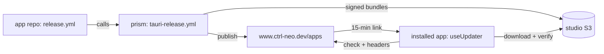

# Publishing NeoMap Editor, and adding the same updater to other Tauri + Nuxt apps

NeoMap Editor updates itself from the studio's release service at `https://www.ctrl-neo.dev/apps`. CI builds, signs and
publishes every new version; installed copies check on launch, download, verify the signature and install.

- **Part 1** is how to publish NeoMap Editor.
- **Part 2** is how to give another Tauri v2 + Nuxt app the same updater and publishing.

The server side (channels, access tokens, registering an app, the shared CI workflow) lives in
[prism](https://github.com/CTRL-Neo-Studios/prism). See its `docs/apps-release-guide.md`; this guide links to it where
the two meet.

---

## Part 1: Publishing NeoMap Editor

### Release a version

1. Bump `"version"` in `src-tauri/tauri.conf.json`.
2. Merge or push to `main`.

That's all. `.github/workflows/release.yml` runs the studio's shared pipeline:

- builds Windows (NSIS), macOS (one universal build for Apple Silicon and Intel) and Linux (AppImage);
- signs each bundle and uploads it;
- publishes to the right channel.

Pushes that **don't** change the version still build, then skip the publish with a notice. Linux is best-effort: if it
fails, Windows and macOS still ship.

The release notes shown in the update prompt are the head commit message. For a merge commit, that's the PR title and
description.

### Pick the version (and therefore the channel)

Versions are strict semver. The prerelease tag picks the channel:

| Version | Channel | Who gets it |
|---|---|---|
| `0.2.0` | `stable` | everyone (default) |
| `0.2.0-beta.1` | `beta` | anyone who picks Beta in the update dialog |
| `0.2.0-insider.1` | `insider` | people with an insider token |
| `0.2.0-team.1` | `team` | people with a team token |

Rules worth knowing:

- **Always put a dot before the number**: `beta.10` sorts after `beta.9`, but `beta10` sorts *before* `beta9`.
- **A prerelease is older than its plain version**: `0.2.0-beta.3 < 0.2.0`.
  - Typical flow: `0.2.0-beta.1` → `0.2.0-beta.2` → `0.2.0`.
  - When `0.2.0` ships to stable, beta users get it too, because beta includes stable.
- **A version can never be replaced.** If `0.2.0` is broken, ship `0.2.1`.
- **Versions only go up**, per channel and on users' machines. There's no downgrade; a fix is always a newer version.
- **Not valid:** `1.0.0.alpha1`, `v1.0`. Tauri refuses to build them.

Full channel and versioning rules: prism's `docs/apps-release-guide.md`.

### Give someone access to insider/team

Restricted channels need an access token. From the prism repo:

```bash
bun run apps:access add alice --grant neomap-editor:insider --note "QA"
```

This prints a `neo_…` token, shown once. Send it to them. In NeoMap Editor they open **Help › Check for updates…**
(macOS: the app menu, under About), pick **Insider**, paste the token, and press **Save and check**. Revoke with
`bun run apps:access revoke alice neomap-editor:insider`; it takes effect within 30 seconds.

### Check a release

- In the editor: **Help › Check for updates…**
- Version metadata: <https://www.ctrl-neo.dev/apps/api/v1/apps/neomap-editor/releases/latest>
- First-install downloads:
  - `https://www.ctrl-neo.dev/apps/download/neomap-editor/windows-x86_64`
  - `https://www.ctrl-neo.dev/apps/download/neomap-editor/darwin-aarch64` (same `.dmg` as `darwin-x86_64`)
  - `https://www.ctrl-neo.dev/apps/download/neomap-editor/linux-x86_64`

### The signing key

Every update is signed with the studio's private key for NeoMap Editor. The app has the matching **public** key built
in (`plugins.updater.pubkey` in `tauri.conf.json`) and refuses anything not signed by it. The public key and the update
URL are safe to have in the repo: neither can be used to publish or install anything.

The private key lives in three places:

- the repo secrets `TAURI_SIGNING_PRIVATE_KEY` (the key file's contents) and `TAURI_SIGNING_PRIVATE_KEY_PASSWORD`;
- the studio password manager;
- whoever generated it (`~/.tauri/neomap-editor.key` and `.password`).

> **Never lose it.** If the private key is lost, every installed copy is stuck on its current version forever: a new
> key means a new public key, which only a manual reinstall can deliver. If it leaks, anyone could sign builds the app
> accepts. Rotate by shipping a release that contains the new public key, signed with the old key, and from then on
> sign with the new one.

### When something goes wrong

| Symptom | Fix |
|---|---|
| CI: *"skipped: … is not newer than …"* | you didn't bump the version (normal for non-release pushes) |
| CI: *".sig missing"* | the signing secrets are missing or wrong |
| CI fails on Linux only | ignored; Windows and macOS still publish. Fix and ship a patch if Linux users need it |
| CI: 401 on publish | the workflow must be the shared one at `@main`, on `main` |
| App says *"Couldn't check for updates"* | offline; or on insider/team with no, wrong or revoked token |
| App doesn't offer a beta | it's on Stable; switch in the update dialog |
| Just published, app doesn't see it | the server caches channels for up to 30 s; check again |

Copies older than 0.1.4 have no updater; those users need to install once manually.

---

## Part 2: Adding the updater to another Tauri + Nuxt app

This assumes an app like NeoMap Editor:

- Tauri v2 with `src-tauri/` at the repo root;
- a Nuxt frontend (`ssr: false`) managed with Bun, with `bun.lock` committed;
- Nuxt UI;
- a repo in the `CTRL-Neo-Studios` org.

The pieces:



### Step 1: Register the app on the server

In prism, add the app to `layers/apps/server/utils/apps.ts` and deploy:

```ts
'my-app': {
	repo: 'CTRL-Neo-Studios/my-app',
	channels: {
		stable: {access: 'public'},
		beta: {access: 'public', includes: ['stable']},
		insider: {access: 'restricted', includes: ['beta', 'stable']}
	}
},
```

The slug (`my-app`) is permanent: it's part of the update URL baked into every installed copy. Details are in prism's
guide.

### Step 2: Generate the app's signing key

Use **one key per app**, so a leak affects only that app.

```bash
umask 077
openssl rand -base64 24 | tr -d '\n' > ~/.tauri/my-app.key.password
bunx tauri signer generate --ci -p "$(cat ~/.tauri/my-app.key.password)" -w ~/.tauri/my-app.key
cat ~/.tauri/my-app.key.pub      # goes into tauri.conf.json
```

Store the key and its password in the studio password manager, then add both as repo secrets:

```bash
gh secret set TAURI_SIGNING_PRIVATE_KEY -R CTRL-Neo-Studios/my-app < ~/.tauri/my-app.key
gh secret set TAURI_SIGNING_PRIVATE_KEY_PASSWORD -R CTRL-Neo-Studios/my-app < ~/.tauri/my-app.key.password
```

### Step 3: Rust and Tauri config

**`src-tauri/Cargo.toml`.** The updater only exists on desktop, and needs Rust 1.90+:

```toml
[package]
rust-version = "1.90"

[target.'cfg(not(any(target_os = "android", target_os = "ios")))'.dependencies]
tauri-plugin-updater = "2.14.0"
```

Your app also needs `tauri-plugin-store` (to remember the channel and token) and `tauri-plugin-process` (to relaunch).
The Nuxt UI + Tauri template already includes both.

**`src-tauri/src/lib.rs`.** Register the plugin on desktop only:

```rust
#[cfg(desktop)] let builder = builder.plugin(tauri_plugin_updater::Builder::new().build());
```

**`src-tauri/tauri.conf.json`:**

```jsonc
{
	"version": "0.1.0",
	"bundle": {
		// no "msi": MSI can't carry prerelease versions like 1.0.0-beta.1
		"targets": ["nsis", "app", "dmg", "appimage", "deb", "rpm"],
		"createUpdaterArtifacts": true
	},
	"plugins": {
		"updater": {
			"pubkey": "<contents of ~/.tauri/my-app.key.pub>",
			// www, not the bare domain: a cross-host redirect drops the channel/token headers
			"endpoints": ["https://www.ctrl-neo.dev/apps/updates/my-app/{{target}}/{{arch}}/{{current_version}}"],
			"windows": {"installMode": "passive"}
		}
	}
}
```

**`src-tauri/capabilities/desktop.json`.** Grant the updater on desktop platforms. Restart is usually already granted
by `process:default` / `process:allow-restart` in `default.json`.

```json
{
	"identifier": "desktop",
	"platforms": ["macOS", "windows", "linux"],
	"windows": ["main", "*"],
	"permissions": ["updater:default"]
}
```

### Step 4: The frontend

```bash
bun add @tauri-apps/plugin-updater@~2.14.0
```

Copy two files from this repo and adjust the marked lines:

- **`app/composables/app/useUpdater.ts`**: no changes needed. It:
  - stores the channel and token in `updates.json` (tauri-plugin-store);
  - sends them as `X-Neo-Channel` / `X-Neo-Token` on the check *and* the download;
  - checks again right before installing, because download links expire after 15 minutes;
  - installs, then relaunches.
- **`app/components/UpdateDialog.vue`**: change two things:
  - `CHANNELS` must match the channels you registered in Step 1;
  - the install button's `confirmDiscard` callback: NeoMap Editor saves or discards open tabs there. Replace it with
    your app's unsaved-work prompt, or `() => Promise.resolve(true)` if the app has none.

If your app auto-imports composables from subfolders, keep `imports: {dirs: ['composables/**']}` in `nuxt.config.ts`.

**Why unsaved work matters:** on Windows, the installer quits the app by itself before installing. Anything not saved
before `install()` runs is lost.

**Why the custom headers:** the updater resends its headers when downloading, and S3 rejects presigned links that also
carry an `Authorization` header. `X-Neo-*` headers pass through harmlessly.

### Step 5: Wire it into the app

**Render the dialog once**, in the root layout:

```vue
<template>
	<!-- … -->
	<UpdateDialog/>
</template>
```

**Check quietly on launch**, in the layout's `<script setup>`. This shows a toast only when something newer exists;
errors stay silent:

```ts
const updater = useUpdater()
const toast = useToast()
onMounted(async () => {
	if (!updater.supported || import.meta.dev) return
	await updater.loadSettings()
	const found = await updater.checkNow()
	if (found) toast.add({
		title: `My App ${found.version} is available`,
		icon: 'i-lucide-download',
		duration: 0,
		actions: [{label: 'View', onClick: () => { updater.dialogOpen.value = true }}],
	})
})
```

**Add a menu entry** that opens the dialog: `updater.dialogOpen.value = true`. In NeoMap Editor:

- **Help › Check for updates…** is a command in `useAppCommands.ts`;
- on macOS it also sits in the app menu under About, in `useAppMenu.ts`.

### Step 6: CI

Replace any existing build workflow with `.github/workflows/release.yml`:

```yaml
name: Release
on:
  push:
    branches: [main]
  workflow_dispatch:
jobs:
  release:
    uses: CTRL-Neo-Studios/prism/.github/workflows/tauri-release.yml@main
    with:
      app: my-app
    secrets: inherit
    permissions:
      contents: read
      id-token: write
```

`id-token: write` lets the job prove to the server which repo and branch it's from; no storage keys are involved.

### Step 7: First release

Set a version, push to `main`, and watch the run. Then:

1. Install that build manually from `https://www.ctrl-neo.dev/apps/download/my-app/<platform>`. Copies built before
   the updater was added can't update themselves.
2. Bump the version and push again.
3. Launch the installed copy: it should offer the update, install it and relaunch.

### Checklist

- [ ] App registered in prism `apps.ts`, prism deployed
- [ ] Signing key generated, stored in the password manager, added as both repo secrets
- [ ] `tauri-plugin-updater` (desktop only), `rust-version = "1.90"`
- [ ] Plugin registered under `#[cfg(desktop)]`
- [ ] `createUpdaterArtifacts`, `pubkey`, `www` endpoint with the app slug, no `msi` target
- [ ] `updater:default` in the desktop capability
- [ ] `useUpdater.ts` + `UpdateDialog.vue` copied, `CHANNELS` and the unsaved-work callback adjusted
- [ ] Dialog in the layout, launch check, menu entry
- [ ] `release.yml` calling the shared workflow with `id-token: write`
- [ ] First build installed manually; second build arrives as an update
